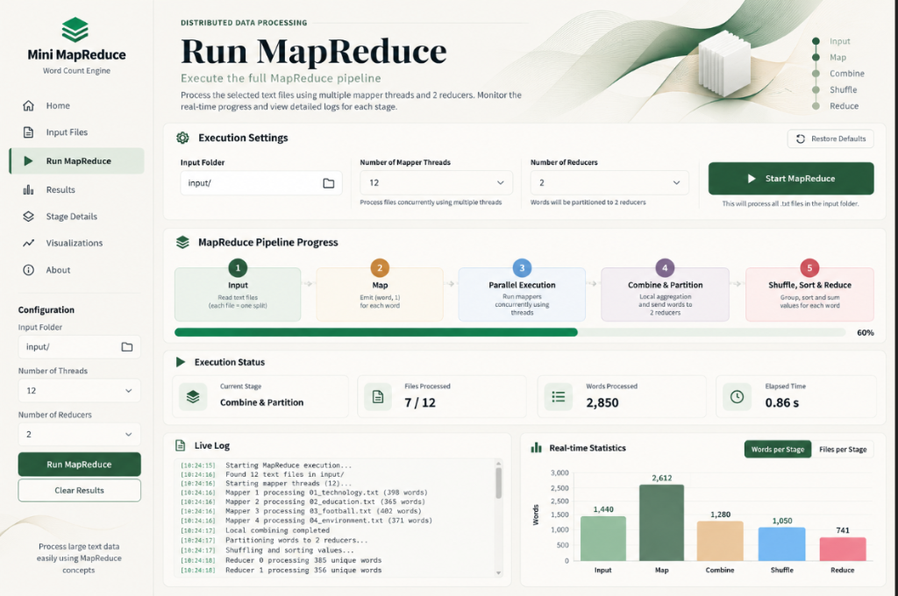
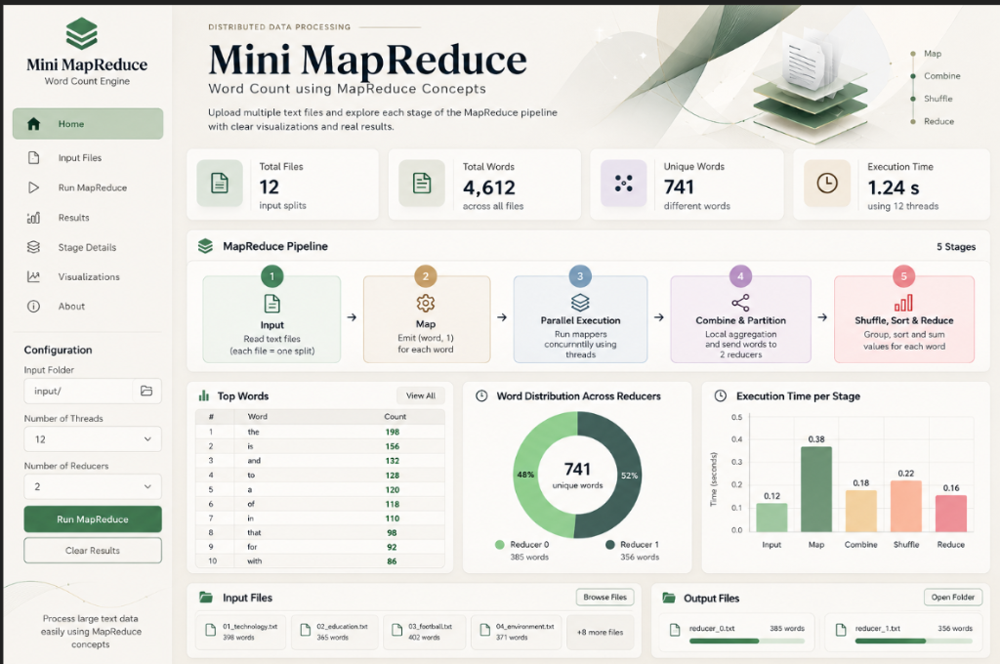
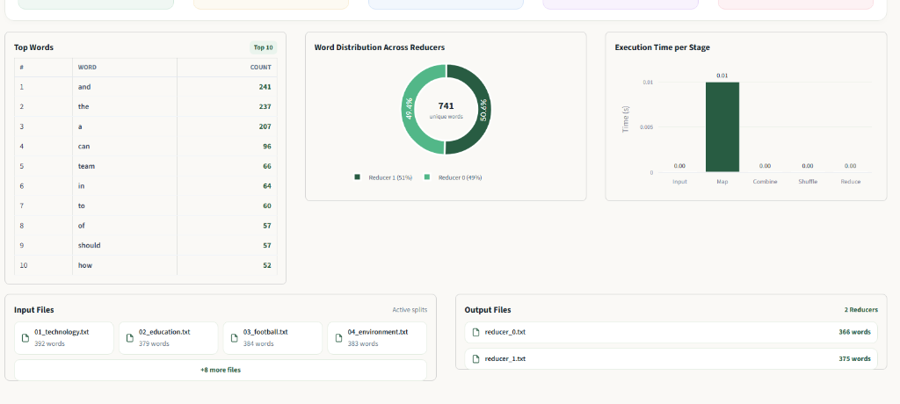
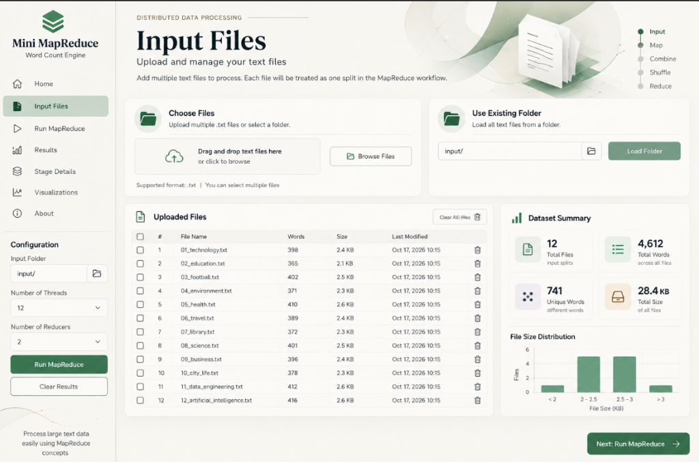

# Mini MapReduce Engine & Analytics Studio

<p align="center">
  
</p>

<p align="center">
  <strong>A Pure Python Distributed Computing Lab & High-Performance Word Count Engine</strong><br>
  <em>Zero external heavy frameworks (No Hadoop, No Spark) • Multithreaded Mappers • Deterministic 2-Reducer Partitioning • Interactive Streamlit SaaS Dashboard</em>
</p>

<p align="center">
  <a href="#key-features">Key Features</a> •
  <a href="#gui-dashboard--demos">GUI Demo</a> •
  <a href="#architecture--pipeline-stages">Architecture</a> •
  <a href="#quick-start">Quick Start</a> •
  <a href="#mathematical-partitioning">Partition Logic</a> •
  <a href="#testing">Testing</a>
</p>

---

## Key Features

- **Standard 5-Stage MapReduce Pipeline**: Full educational implementation of **Input Splitting**, **Mapping**, **Thread-Parallel Execution**, **Local Combining & Partitioning**, and **Shuffle / Sort / Reduction**.
- **Deterministic 2-Reducer Partitioning**: Balanced hashing using the character ASCII-sum modulo formula: `sum(ord(c)) % 2`.
- **Pure Python Core (`engine.py`)**: Clean, dependency-free backend utilizing Python standard libraries (`ThreadPoolExecutor`, `collections.defaultdict`, `dataclasses`).
- **Interactive SaaS Analytics Dashboard (`app.py`)**:
  - Warm minimalist SaaS theme (`#FAF9F6`, `#285C42`, `#DCE8DC`).
  - **Cloud-Ready Drag-and-Drop Ingestion**: Drag and drop single or multiple `.txt` splits directly on both the **Home** and **Run MapReduce** pages.
  - **1-Click Benchmark Dataset Loader**: Load bundled benchmark sample files or clear datasets in 1 click.
  - **Dynamic Zero-State Architecture**: Clean, zero-state dashboard that dynamically updates without hardcoded fallback numbers when deployed to Streamlit Cloud.
  - Real-time live execution logs with green timestamps.
  - Interactive stage latency analysis measured in **milliseconds (`ms`)**.
  - Dynamic **Word Partition Route Inspector** to trace any token's routing.
  - **Per-File Data Reduction & Combiner Efficiency** chart.
  - Stateful Input File Manager with upload, hide, unhide, and delete controls.

- **Dual Mode**:
  - Run via **Interactive Web GUI** (`streamlit run app.py`).
  - Run via **Headless CLI** (`python main.py`).

---

## GUI Dashboard & Demos

### 1. Run MapReduce Dashboard
Full execution controls, interactive progress tracker, live stage telemetry, execution terminal log, and real-time stage metric distribution.



---

### 2. Primary Executive Dashboard
Overview of processed splits, total volume, word reduction stats, interactive top-word frequency bar chart, and reducer load distribution.



---

### 3. Interactive Analytics & Reducer Partition Route Inspector
Inspect stage latency in milliseconds, trace word hashing routes, and analyze per-file combiner compression efficiency.



---

### 4. Input Splits Manager
Manage active text splits, upload new text files, inspect file size distributions, and exclude files without permanent deletion.



---

## Architecture & Pipeline Stages

```text
   [ input/*.txt ]  (12 Independent Data Splits)
          │
          ▼
   ┌────────────────────────────────────────────────────────┐
   │ 1. INPUT SPLITTING                                     │
   │ Each .txt file is treated as an isolated split.        │
   └──────────────────────┬─────────────────────────────────┘
                          │
                          ▼
   ┌────────────────────────────────────────────────────────┐
   │ 2 & 3. CONCURRENT MAP WORKERS (ThreadPoolExecutor)     │
   │ Tokenize text & emit raw key-value pairs (word, 1).    │
   └──────────────────────┬─────────────────────────────────┘
                          │
                          ▼
   ┌────────────────────────────────────────────────────────┐
   │ 4. LOCAL COMBINER & DETERMINISTIC PARTITIONING         │
   │ Local in-memory reduction per file.                    │
   │ Route each word to Reducer 0 or 1 via sum(ord(c)) % 2. │
   └──────────┬─────────────────────────────────┬───────────┘
              │                                 │
     (Even Hash = 0)                    (Odd Hash = 1)
              ▼                                 ▼
   ┌──────────────────────┐          ┌──────────────────────┐
   │ 5A. REDUCER 0        │          │ 5B. REDUCER 1        │
   │ Shuffle, Sort, Sum   │          │ Shuffle, Sort, Sum   │
   │ output/reducer_0.txt │          │ output/reducer_1.txt │
   └──────────────────────┘          └──────────────────────┘
```

### Stage Details

1. **Input Splitting (`input/*.txt`)**:
   - Files are loaded independently as individual splits without prior concatenation.
2. **Map (`mapper`)**:
   - Words are normalized (`lowercase`, punctuation stripped, supporting English and Arabic).
   - Emits a raw `(word, 1)` pair for every single occurrence.
3. **Parallel Execution (`ThreadPoolExecutor`)**:
   - Mappers run concurrently across configurable threads (1, 2, 4, 8, 12, 16).
4. **Local Combiner (`combiner`)**:
   - Reduces network/memory transfer by aggregating word counts locally within each split before partitioning.
5. **Deterministic Partitioning (`partitioner`)**:
   - Evaluates the ASCII sum of the word modulo 2: `sum(ord(c)) % 2`.
   - Guarantees that any given word always lands on the exact same reducer.
6. **Shuffle, Sort & Reduce (`reducer`)**:
   - Groups values per key across all partitions.
   - Alphabetically sorts keys and sums occurrences.
   - Writes `output/reducer_0.txt` and `output/reducer_1.txt`.

---

## Quick Start

### Prerequisites
- Python 3.9+ (compatible with Python 3.10, 3.11, 3.12, 3.13, 3.14)
- Virtual environment recommended

### Installation

1. **Clone the repository:**
   ```bash
   git clone https://github.com/MohameddTamerr/Big-Data-Analytics.git
   cd Big-Data-Analytics
   ```

2. **Create and activate a virtual environment:**
   - **Windows:**
     ```powershell
     python -m venv .venv
     .venv\Scripts\activate
     ```
   - **Linux / macOS:**
     ```bash
     python3 -m venv .venv
     source .venv/bin/activate
     ```

3. **Install dependencies:**
   ```bash
   pip install -r requirements.txt
   ```

---

## Usage

### Option A: Run Interactive Web Dashboard (Recommended)
```bash
streamlit run app.py
```
Open your browser at `http://localhost:8501`.

### Option B: Run via Headless Terminal CLI
```bash
python main.py
```
Processes all files in `input/` and writes results to `output/reducer_0.txt` and `output/reducer_1.txt`.

---

## Mathematical Partitioning

The deterministic routing formula ensures consistent partition assignments:

$$\text{Reducer ID} = \left( \sum_{i=1}^{n} \text{ord}(c_i) \right) \pmod 2$$

#### Verification Examples:

| Word | ASCII Values Calculation | Total ASCII Sum | Modulo `% 2` | Assigned Target |
| :--- | :--- | :--- | :--- | :--- |
| `data` | $100 + 97 + 116 + 97$ | $410$ | $0$ | **Reducer 0** |
| `processing` | $112 + 114 + 111 + 99 + 101 + 115 + 115 + 105 + 110 + 103$ | $1085$ | $1$ | **Reducer 1** |
| `mapreduce` | $109 + 97 + 112 + 114 + 101 + 100 + 117 + 99 + 101$ | $950$ | $0$ | **Reducer 0** |
| `technology` | $116 + 101 + 99 + 104 + 110 + 111 + 108 + 111 + 103 + 121$ | $1084$ | $0$ | **Reducer 0** |

---

## Project Structure

```text
mini-mapreduce-engine/
│
├── engine.py             # Pure Python MapReduce Engine (Core Logic)
├── main.py               # Headless CLI entry point
├── app.py                # Streamlit SaaS Interactive Dashboard
├── requirements.txt      # Dashboard dependencies (streamlit, pandas, plotly)
├── logo.png              # Official vector-raster transparent brand emblem
│
├── input/                # Default text splits (12 sample text files)
│   ├── 01_technology.txt
│   ├── 02_education.txt
│   └── ...
│
├── output/               # Output directory created automatically
│   ├── reducer_0.txt     # Alphabetically sorted words for Reducer 0
│   └── reducer_1.txt     # Alphabetically sorted words for Reducer 1
│
├── docs/                 # Documentation assets & screenshots
│   └── images/
│       ├── run_mapreduce_dashboard.png
│       ├── home_dashboard.png
│       ├── analytics_cards.png
│       ├── input_files_manager.png
│       └── logo.png
│
└── tests/                # Automated test suite
    └── test_engine.py    # Unit tests for mapper, combiner, partitioner, reducer
```

---

## Testing

Run the automated test suite verifying tokenization, deterministic partitioning, parallel workers, and reducer output generation:

```bash
python -m unittest discover tests
```

Output:
```text
.......
----------------------------------------------------------------------
Ran 7 tests in 0.012s

OK
```

## Acknowledgements & Special Thanks

Special thanks and sincere gratitude to **[Dr. Ahmed Said](https://github.com/dr-ahmed-said)** for his mentorship, inspiration, and invaluable guidance throughout this distributed computing and MapReduce project.

<p align="left">
  <a href="https://github.com/dr-ahmed-said">
    
  </a>
</p>

- **Supervisor & Mentor**: **[Dr. Ahmed Said](https://github.com/dr-ahmed-said)**
- **Role**: Assistant Professor in Artificial Intelligence / Computer Science
- **GitHub Profile**: [@dr-ahmed-said](https://github.com/dr-ahmed-said)

---

## License
MIT License. Free for educational and research use.

## Student Instructions


---

## Original Repository Instructions


